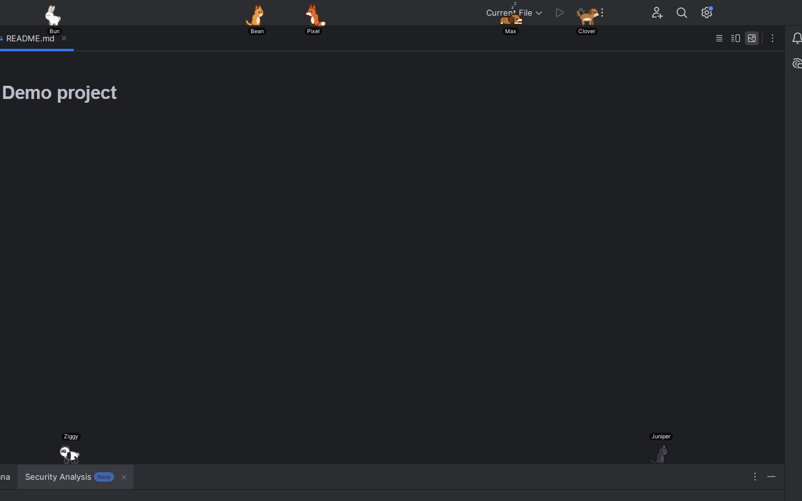
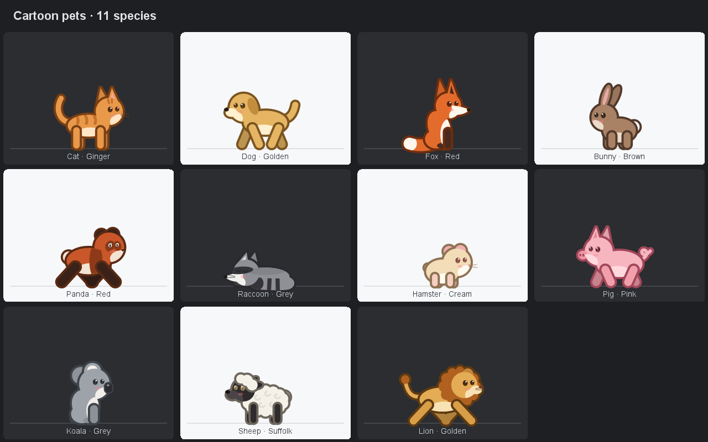
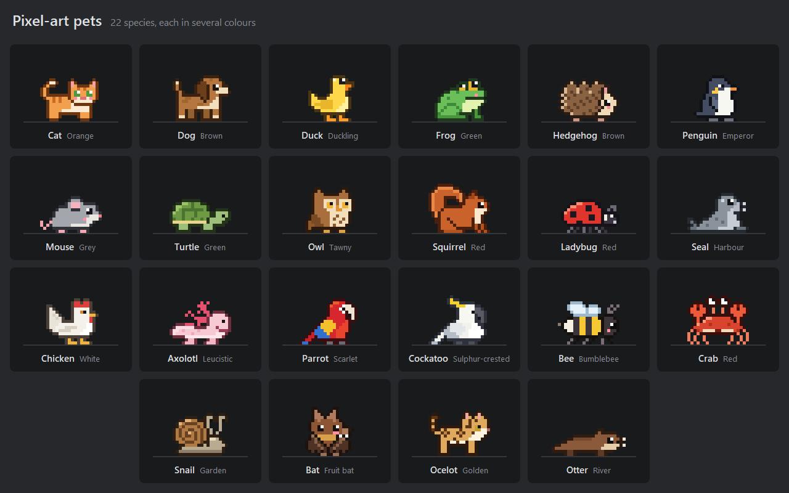

# Code Gschpänli

[](https://github.com/ProgrammiererEFZ/code-gschpaenli/actions/workflows/build.yml)
[](LICENSE)
<!-- After the first Marketplace upload, add (replace MARKETPLACE_ID with the numeric id from the plugin page URL):
[](https://plugins.jetbrains.com/plugin/MARKETPLACE_ID)
[](https://plugins.jetbrains.com/plugin/MARKETPLACE_ID)
-->

Little pets that live **on your JetBrains IDE itself**, with no extra tool window. They walk along the window header
and the status bar, nap on top of tool windows, climb up and down tool window borders, jump between surfaces, and chase
balls you throw.

Works in IntelliJ-based IDEs 2025.2 and newer (IntelliJ IDEA, PhpStorm, PyCharm, ...).



"Gschpänli" is Swiss German for "little buddies": the companions that keep you company while you code.

## Features

- **Two art styles**
  - *Cartoon*: smooth, procedurally drawn cat, dog, fox, bunny, panda, raccoon, hamster and pig
  - *Pixel art*: hand-made sprites of a cat, dog, duck, frog, hedgehog, penguin, mouse and turtle
  - Every species comes in several colours.
- **Pets live on the IDE's own UI.** Each window's Swing hierarchy is scanned for edges (window header, status bar,
  tool window tops, editor tab bars, toolbars, dividers). The horizontal edges become floors and the vertical borders
  become climbable walls. Pets fall when the layout changes under them.
- **Interaction**
  - Click a pet to pet it (hearts).
  - Drag a pet to pick it up, then throw it.
  - **Tools | Code Gschpänli | Throw Ball** sends every pet chasing a ball.
- **Random visitors:** on by default, a changing crowd of one to three pets drops by, stays one to eight minutes, and walks off again.
  You set the range, for example "between 1 and 3 at a time". Use the same number twice for a fixed count.
- **Settings** (*Settings | Tools | Code Gschpänli*):
  - size, speed and activity
  - name tags on/off
  - pause while the IDE is in the background
  - which IDE parts pets may walk on
  - visitors (range, which art styles)
  - your adopted pets
- **Tools | Code Gschpänli** menu: Adopt a Pet, Throw Ball, Roll Call, Show Pets, Show Name Tags, Random Visitors,
  Remove Pet, Remove All Pets

| Cartoon pets | Pixel-art pets |
| --- | --- |
|  |  |

To hide all pets, untick **Tools | Code Gschpänli | Show Pets**. Pets also pause while *File | Power Save Mode* is on. The plugin collects no data and makes no network requests.

## Install

1. Build the plugin (below), or download the ZIP attached to a [GitHub release](https://github.com/ProgrammiererEFZ/code-gschpaenli/releases).
2. In the IDE, open *Settings | Plugins*, click the gear icon, choose *Install Plugin from Disk...*, and select the zip.

## Build and run

You need JDK 21 (any distribution; the JBR bundled with an IntelliJ IDEA 2025.2+ install works) and nothing else: the
Gradle wrapper downloads Gradle, and Gradle downloads IntelliJ IDEA Community `platformVersion` (see
`gradle.properties`) to compile against, just like CI does.

```bash
./gradlew build                # compile, unit tests, plugin ZIP in build/distributions/
./gradlew runIde               # sandbox IntelliJ IDEA with the plugin
./gradlew verifyPlugin         # IntelliJ Plugin Verifier (downloads the IDEs it checks against)
```

To skip the IDE download, point the build to an installed IDE (2025.2 or newer), on the command line or in
`~/.gradle/gradle.properties`:

```bash
./gradlew runIde -PlocalIde="C:/Program Files/JetBrains/IntelliJ IDEA Community Edition 2025.2"
./gradlew verifyPlugin -PlocalVerifierIdes="C:/Program Files/JetBrains/IntelliJ IDEA Community Edition 2025.2,C:/Program Files/JetBrains/PhpStorm 2026.2.3"
```

Development helpers:

- `./gradlew runPhpStorm` / `runPyCharm` run a sandbox of a local PhpStorm / PyCharm (2025.2 or newer). They exist only
  when the IDE is installed at the default path; set another one with `-PphpStormPath=<dir>` / `-PpyCharmPath=<dir>`.
- `-PopenProject=<dir>` opens a project in the sandbox.
- `-PpetsDebugDir=<dir>` makes the sandbox write a PNG snapshot of every window, plus the detected surfaces, walls and
  pet states, every few seconds.
- `-PpetsPerfLog=<file>` runs a benchmark of about 11 minutes: pets off, 1 pet and 6 pets, each at 30 and 60 fps. It
  appends frame timing, UI-thread and process CPU, allocations and GC per phase to `<file>`, restores the pets and closes
  the sandbox. Keep the sandbox window un-minimised while it runs. Combine it with `-PopenProject` so the editor shows
  a file.

## Releasing

1. Describe the changes under `## [Unreleased]` in `CHANGELOG.md` and set `pluginVersion` in `gradle.properties`.
2. Push to `main`. The *Build* workflow builds, tests and verifies the plugin and creates a draft GitHub release with
   the tag `v<pluginVersion>`.
3. Publish the draft release. The *Release* workflow builds the plugin (signed, when the signing secrets exist),
   uploads it to the JetBrains Marketplace when `PUBLISH_TOKEN` exists, attaches the ZIP to the release and opens a
   pull request that moves the changelog entries under the new version. Merge that pull request.

The very first version must be uploaded by hand on <https://plugins.jetbrains.com/plugin/add>: publish the first
release without the `PUBLISH_TOKEN` secret, then upload the ZIP attached to it. Add `PUBLISH_TOKEN` afterwards.

Repository secrets: `PUBLISH_TOKEN` (Marketplace token), and optionally `CERTIFICATE_CHAIN`, `PRIVATE_KEY` and
`PRIVATE_KEY_PASSWORD` ([plugin signing](https://plugins.jetbrains.com/docs/intellij/plugin-signing.html)). The
changelog pull request also needs *Settings > Actions > General > Allow GitHub Actions to create and approve pull
requests*.

## How it works

All paths are under `src/main/java/io/github/programmiererefz/codegschpaenli/`.

| Piece | Where |
| --- | --- |
| One transparent overlay per project window, in the window's `JLayeredPane` at layer 150. It sits above all IDE content and below popups, menus and balloons. It only claims mouse events over a pet; wheel events are passed through. | `overlay/PetOverlay.java` |
| Frame tracking and the animation timer. It runs at 60 fps while something moves and idles at 2 fps otherwise. On Windows it asks for 1 ms timer resolution while animating, because the default ~15.6 ms clock tick makes 60 fps stutter. | `overlay/PetOverlays.java`, `overlay/TimerResolution.java` |
| Surface and wall detection. It matches IDE classes by simple class name, including superclasses, so it never links against internal API. | `overlay/SurfaceScanner.java` |
| Simulation: walking, jumping, climbing, falling, the ball, visitors arriving and leaving. Pure Java, so it can be tested headless. | `world/World.java` |
| Vector renderer for the cartoon pets | `render/PetRenderer.java` |
| Pixel sprites, as character grids mapped to palette slots | `pixel/Pixel*.java` |

## Known limitations

- Pets live only in main project windows, not in floating or undocked tool windows or detached editors.
- On Windows, a pet standing in the custom title-bar area may sometimes start a window drag when you grab it.
- Tool windows that slide in over the editor don't hide the edges underneath them, so pets may walk "behind" such a
  window's area.

## License

Copyright (C) 2026 ProgrammiererEFZ

Code Gschpänli is free software: you can redistribute it and/or modify it under the terms of the GNU General Public License
version 3 only (`GPL-3.0-only`), as published by the Free Software Foundation. It is distributed WITHOUT ANY WARRANTY.
See [LICENSE](LICENSE) for the full text.

Because the plugin runs inside JetBrains IDEs, which are partly proprietary, it comes with an additional permission
under GPL section 7 that allows combining it with IntelliJ Platform-based products. See [NOTICE](NOTICE).

All art is original. No sprites from other pet plugins are used.

IntelliJ IDEA, PhpStorm, PyCharm and JetBrains are trademarks of JetBrains s.r.o. This project is not affiliated with
JetBrains.
